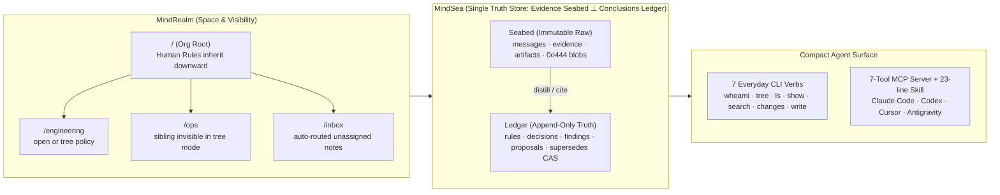

# Meru Mind

**Scoped, versioned shared context for human-AI teams.**

[中文文档 (README.zh-CN.md)](./README.zh-CN.md) · [Realm Method](./docs/REALM_METHOD.md) · [Architecture](./ARCHITECTURE.md) · [Threat Model](./THREAT_MODEL.md) · [Cloud Deployment & Composable UI Guide](./docs/deployment-and-frontend.md) · [UI Builder Skill](./docs/UI_BUILDER_SKILL.md)

Meru Mind is a zero-Docker, single-SQLite TypeScript engine (`CLI` + `MCP Server` + `HTTP/WS Server` + `Composable Web UI` + `SDK`) that separates **space & visibility (`MindRealm`)** from **time & truth depth (`MindSea`)** — so multiple humans and coding agents can share rules, decisions, and evidence without context flooding, stale-fact regressions, or cross-branch leakage.



---

## Why Meru Mind?

- **Tree-scoped visibility (`open | tree`)**: Every read, search, vector KNN query, and slice export passes through one pure policy engine (`src/policy.ts`). In `tree` mode, sibling branches are excluded **before Top-K**; ancestor rules inherit downward; cross-branch reads require explicit `@mount`.
- **Single truth store, layered into Evidence (`Seabed`) and Conclusions (`Ledger`)**: Inside one canonical SQLite store, immutable raw evidence (`seabed_entries` + `0o444` content-addressed `blobs/`) stays layered beneath structured conclusions (`records` with atomic `supersedes` chains and compliance-grade `redact`). All derived indexes (FTS5, optional `sqlite-vec`) can be destroyed and reconstructed via `admin rebuild`.
- **Zero-Docker, deterministic speed**: Built directly on Node.js 22+ built-in `node:sqlite` (WAL + FTS5 + local-passage windowed coverage) with optional `sqlite-vec` embeddings.
- **Minimal 7-tool MCP + 23-line Skill**: Agents follow a deterministic `whoami -> tree -> show <realm> -> search` rhythm without burning context budget.

---

## 60-Second Quick Start

Requires **Node.js >= 22.13** (uses built-in `node:sqlite`, currently an experimental Node.js API tested in CI on Node 22 & 24).

```bash
pnpm install
pnpm build
pnpm test
```

Runtime data is **always stored outside the repository** (defaults to `~/.meru-mind`, or override via `MERU_MIND_HOME` / `--home`).

```bash
export MERU_MIND_HOME="$HOME/.meru-mind-quickstart"

# 1. Initialize an organization & root realm
node dist/cli.js admin init --org "Acme"

# 2. Create child realms (topology mutations require --as-human)
node dist/cli.js realm create --parent / --slug backend --name "Backend" --scope "Include: APIs, storage, deploys. Exclude: marketing." --as-human
node dist/cli.js realm create --parent / --slug marketing --name "Marketing" --scope "Include: launches, campaigns. Exclude: infra." --as-human

# 3. Record a human rule, a scoped decision, and an unassigned note (auto-routes to /inbox)
node dist/cli.js rule add --in / --title "Never deploy without green CI" --body "All production merges require passing tests." --as-human
node dist/cli.js write --in /backend --kind decision --title "Standardize on SQLite WAL for local state" --body "Single-writer WAL keeps solo workflows zero-Docker."
node dist/cli.js write --title "Investigate p95 spike" --body "Omitted --in lands cleanly in /inbox for triage."

# 4. Inspect identity, realm tree, and cold-start brief (inherits root rules automatically)
node dist/cli.js whoami
node dist/cli.js tree
node dist/cli.js show /backend

# 5. Scoped full-text search (local-passage windowed coverage + supersede suppression)
node dist/cli.js search "SQLite WAL" --in /backend

# 6. Triage /inbox and archive obsolete realms (human-only)
node dist/cli.js entry move <rec_id> --to /backend --dry-run --as-human
node dist/cli.js realm archive /marketing --as-human

# 7. Start the single-writer HTTP + Pump WS + Streamable HTTP MCP + Web UI server (seeded demo)
node dist/cli.js serve --demo --host 127.0.0.1 --port 3800

# 8. Optional: eject the built-in shell for custom Agent-authored UI, or bind Linear/GitHub SSOT
node dist/cli.js ui eject ./my-custom-ui
node dist/cli.js work bind --in /backend --provider github --repo acme/api --token-env GITHUB_TOKEN --as-human
```

---

## MCP Server & Official Agent Skill

`meru-mind-mcp` exposes **7 read/write tools** (`mind_whoami`, `mind_tree`, `mind_ls`, `mind_show`, `mind_search`, `mind_changes`, `mind_write`) with `actor.kind` hardcoded to `"agent"` (human-only governance commands remain CLI-only).

```json
{
  "mcpServers": {
    "meru-mind": {
      "command": "node",
      "args": ["/path/to/meru-mind/dist/mcp.js"],
      "env": {
        "MERU_MIND_HOME": "/path/to/your/data-dir"
      }
    }
  }
}
```

Pair it with the official 23-line everyday skill at [`skills/meru-mind/SKILL.md`](./skills/meru-mind/SKILL.md) for Claude Code, Codex, Cursor, or Antigravity. For bootstrapping realm trees, migrating legacy vaults, or periodic `admin doctor` hygiene, see [`docs/REALM_METHOD.md`](./docs/REALM_METHOD.md) and the on-demand curator skill at [`skills/meru-mind-curator/SKILL.md`](./skills/meru-mind-curator/SKILL.md).

### Optional Semantic Vector Search (`sqlite-vec`)

When unconfigured or offline, Meru Mind runs 100% deterministically on FTS5. Configure any OpenAI-compatible embedding endpoint to enable hybrid FTS5 + `sqlite-vec` RRF recall:

```bash
export MERU_MIND_EMBED_URL="https://api.openai.com/v1"
export MERU_MIND_EMBED_API_KEY="your-key"
export MERU_MIND_EMBED_MODEL="text-embedding-3-small"
export MERU_MIND_EMBED_DIM="1536"
```

---

## Stability Guarantees, Experimental Surfaces & Known Limitations

### Stability & Storage Guarantees (`0.x`)
- **Stable in `0.x`**: the **7 everyday CLI verb names** (`whoami`, `tree`, `ls`, `show`, `search`, `changes`, `write`), the **7 MCP tool names**, the **`MindSurface` TypeScript facade**, and **forward-only SQLite schema compatibility** (`mind.sqlite` files created by `v0.2.0` remain readable by newer releases, with automatic pre-migration `VACUUM INTO` backups; downgrades are unsupported).
- **Unstable in `0.x`**: Markdown output formatting, ranking weights, and lower-level internal adapter exports.
- **Experimental surfaces** (marked `[experimental]` in `--help`, excluded from the official Agent Skill): `file` (local shared drive), `raw` (direct seabed CLI capture), `settle` (distillation cards), and the `thing` record kind.
- **SQLite canonical backend**: SQLite (`node:sqlite` WAL) is the sole core backend and online source of truth. Migrating to Postgres is a future trigger-based project (not a zero-rewrite port swap).

### Known Limitations (`v0.5.1`)
1. **Lexical-only by default**: Without an external embedding endpoint configured, recall relies purely on CJK-bigram + Latin FTS5 and windowed coverage.
2. **Bulk import does not auto-link `supersedes`**: Imported Markdown/JSONL entries without explicit `supersedes` references remain active side-by-side until explicitly linked (live writes return a neutral related-active echo so agents can link them explicitly).
3. **Single-writer SQLite server model**: `meru-mind serve` takes an exclusive writer lock on `mind.sqlite` and expects persistent local block storage (avoid multi-replica containers over NFS/SMB).
4. **`node:sqlite` experimental runtime**: Node.js currently marks `node:sqlite` experimental; CI verifies both Node 22 and Node 24.

---

## Internal Benchmark Methodology & Results (With Full Caveats)

We evaluated Meru Mind (lexical-only, `vector_enabled: false`) against a real-world Markdown/JSONL file-based knowledge vault baseline across **7 zero-overlap holdout rounds (Rounds 2–8, 222 paired questions)** using air-gapped blind agents under equal tool-call and stdout-character budgets, graded by anonymized blind judges (Rounds 6–8 were pre-audited for blinding leaks, air-gapped from host memory/rules, and double-graded across independently flipped/shuffled A/B orders):

- **7-round cumulative (222 zero-overlap paired questions, R2–R8)**: Meru Mind **`181/222 (81.5%)`** full-correct vs baseline **`161/222 (72.5%)`** (`+9.0 pp`); strict paired score wins **`45W / 17L / 160T`** (exact two-sided binomial sign test **`p = 0.0005`**).
- **Latest Round 8 (`v0.5.1`, air-gapped Skill-vs-Skill, 31 valid paired questions; Meru Mind `0/32` errors, baseline `1/32` parser error isolated)**:
  - **Primary blind judge**: Meru Mind **`26/31 (83.9%)`** (`87.1%` avg score, `22/27` answerable, `4/4` negative abstention, `0/6` superseded regressions) vs baseline **`23/31 (74.2%)`** (`79.0%` avg score, `19/27` answerable, `4/4` negative abstention, `0/6` superseded regressions); strict paired **`6W / 2L / 23T`** (mechanical `v0.5.0` replay and exact CLI diff confirmed `0` regressions attributable to `v0.5.1`).
  - **Second blind judge (independently reversed/shuffled)**: Meru Mind **`24/31 (77.4%)`** (`83.9%` avg) vs baseline **`22/31 (71.0%)`** (`77.4%` avg), paired **`7W / 4L / 20T`**; strict order agreement **`28/31 (90.3%)`** (`12/14 = 85.7%` on opposite A/B flips).
  - **Kernel retrieval & latency**: Gold Hit@10 **`22/28 (78.6%)`** vs baseline **`18/28 (64.3%)`** (`+14.3 pp`), MCP warm **`p50 = 33.1 ms / p95 = 69.6 ms`**, CLI cold **`p50 = 155.4 ms`** vs **`5,092.5 ms`** (`32.8×` faster), average end-to-end tool time **`499 ms`** vs **`8,151 ms`** (`16.3×` faster), average stdout **`6,579` vs `8,531` chars** (`-22.9%`).

> **Honest Caveats**:
> 1. The evaluation corpus is a private personal/engineering vault (21,166 atoms + 2,104 Markdown docs) and cannot be redistributed publicly (benchmark scripts stay outside this repository).
> 2. Vector search was disabled throughout (`vector_enabled: false`) to isolate the deterministic SQLite FTS5 + realm/supersede kernel.
> 3. The 222-question cumulative result spans iterative releases (`v0.2a Slice 1` through `v0.5.1`, zero overlap across rounds) rather than a single frozen commit; single-round `n = 31` verifies no regression, while statistical significance comes from the 7-round cumulative set.
> 4. Both blind judges belong to the same model family (same-family dual audit with independent A/B reversal and batch shuffling, not cross-family independence).

---

## Shipped Capabilities (`v0.2.0` → `v0.5.1`)

See [`docs/deployment-and-frontend.md`](./docs/deployment-and-frontend.md), [`docs/UI_BUILDER_SKILL.md`](./docs/UI_BUILDER_SKILL.md), and [`THREAT_MODEL.md`](./THREAT_MODEL.md) for deployment, security, and custom UI authoring details:

- **`v0.2.0`**: Scoped `MindRealm` (`open | tree` + `@mount`), single-store layered `MindSea` (`Seabed ⊥ Ledger`), 7-verb CLI, 7-tool stdio MCP + 23-line Skill, compliance `redact`, read-only slices, and Node 22/24 CI.
- **`v0.2.1`**: Directional cross-kind `supersedes`, neutral write-time related-entry echo, exact same-day timestamp preservation on import, deterministic L1 brief selection (rules never silently truncated), and automatic pre-migration `VACUUM INTO` backups.
- **`v0.3.0`**: Unified `MindSurface` (`LocalMindSurface` / `RemoteMindSurface`), single-writer `meru-mind serve` with exclusive lock, hashed Bearer tokens (`meru-mind token`), write-time Secret Guard, Pump Model + Long-Poll (`GET /v1/changes?wait=25`), Streamable HTTP MCP (`/mcp`), `meru-mind admin backup`, and Cloud Deploy Kit (`deploy/Dockerfile`, `docker-compose.yml`, `Caddyfile`, `fly.toml`).
- **`v0.4.0`**: 1.5-layer zero-extra-package composable Web Governance UI — server-hosted `/_meru/client.js` (Pump, CAS `inbox.triage()`, sanitized Shadow DOM `<meru-entry>`, visible-scope snapshots), built-in `/_meru/shell`, 7-condition Pump WebSocket (`WS /v1/ws`), in-process `MindPulse`, 60s single-use CLI browser login (`meru-mind ui login` -> weakened `HttpOnly; SameSite=Strict` Cookie), `meru-mind ui eject`, `--demo` adversarial sandbox, and 6 hard security guardrails.
- **`v0.5.0`**: Narrow SSOT `WorkProvider` contract (zero task tables in `mind-core`, MCP stays strictly 7 tools), official Linear & GitHub providers, `work_bindings` (`env:VAR` secret refs only), circuit-breaker degradation, `DeliveryRetryWorker` exponential backoff + dead-lettering, and local/remote `meru-mind work` CLI commands.
- **`v0.5.1`**: FTS5-aligned underscore (`_`) word boundary verification (plain words and pure `snake_case` align with SQLite FTS5 `unicode61` while delimiter identifiers `- / :` keep strict sibling-service isolation; zero DB migration) and coverage-first `<= 240`-char 2-segment snippet synthesis with candidate-pool rare-term prioritization (`100%` byte-identical fast path when title + Window 1 already cover all matched concepts).

## License

MIT
