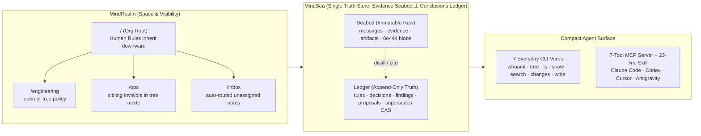

# Meru Mind

**Scoped, versioned shared context for human-AI teams.**

[中文文档 (README.zh-CN.md)](./README.zh-CN.md) · [Architecture](./ARCHITECTURE.md) · [Cloud Deployment & Composable UI Guide](./docs/deployment-and-frontend.md)

Meru Mind is a zero-Docker, single-SQLite TypeScript engine (`CLI` + `MCP Server` + `SDK`) that separates **space & visibility (`MindRealm`)** from **time & truth depth (`MindSea`)** — so multiple humans and coding agents can share rules, decisions, and evidence without context flooding, stale-fact regressions, or cross-branch leakage.



---

## Why Meru Mind?

- **Tree-scoped visibility (`open | tree`)**: Every read, search, vector KNN query, and slice export passes through one pure policy engine (`src/policy.ts`). In `tree` mode, sibling branches are excluded **before Top-K**; ancestor rules inherit downward; cross-branch reads require explicit `@mount`.
- **Single truth store, layered into Evidence (`Seabed`) and Conclusions (`Ledger`)**: Inside one canonical SQLite store, immutable raw evidence (`seabed_entries` + `0o444` content-addressed `blobs/`) stays layered beneath structured conclusions (`records` with atomic `supersedes` chains and compliance-grade `redact`). All derived indexes (FTS5, optional `sqlite-vec`) can be destroyed and reconstructed via `admin rebuild`.
- **Zero-Docker, deterministic speed**: Built directly on Node.js 22+ built-in `node:sqlite` (WAL + FTS5 + local-passage windowed coverage) with optional `sqlite-vec` embeddings.
- **Minimal 7-tool MCP + 23-line Skill**: Agents follow a deterministic `whoami -> tree -> show <realm> -> search` rhythm without burning context budget.

---

## 60-Second Quick Start

Requires **Node.js >= 22.13** (uses built-in `node:sqlite`, currently an experimental Node.js API tested in CI on Node 22 & 24).

```bash
pnpm install
pnpm build
pnpm test
```

Runtime data is **always stored outside the repository** (defaults to `~/.meru-mind`, or override via `MERU_MIND_HOME` / `--home`).

```bash
export MERU_MIND_HOME="$HOME/.meru-mind-quickstart"

# 1. Initialize an organization & root realm
node dist/cli.js admin init --org "Acme"

# 2. Create child realms (topology mutations require --as-human)
node dist/cli.js realm create --parent / --slug backend --name "Backend" --scope "Include: APIs, storage, deploys. Exclude: marketing." --as-human
node dist/cli.js realm create --parent / --slug marketing --name "Marketing" --scope "Include: launches, campaigns. Exclude: infra." --as-human

# 3. Record a human rule, a scoped decision, and an unassigned note (auto-routes to /inbox)
node dist/cli.js rule add --in / --title "Never deploy without green CI" --body "All production merges require passing tests." --as-human
node dist/cli.js write --in /backend --kind decision --title "Standardize on SQLite WAL for local state" --body "Single-writer WAL keeps solo workflows zero-Docker."
node dist/cli.js write --title "Investigate p95 spike" --body "Omitted --in lands cleanly in /inbox for triage."

# 4. Inspect identity, realm tree, and cold-start brief (inherits root rules automatically)
node dist/cli.js whoami
node dist/cli.js tree
node dist/cli.js show /backend

# 5. Scoped full-text search (local-passage windowed coverage + supersede suppression)
node dist/cli.js search "SQLite WAL" --in /backend

# 6. Triage /inbox and archive obsolete realms (human-only)
node dist/cli.js entry move <rec_id> --to /backend --dry-run --as-human
node dist/cli.js realm archive /marketing --as-human
```

---

## MCP Server & Official Agent Skill

`meru-mind-mcp` exposes **7 read/write tools** (`mind_whoami`, `mind_tree`, `mind_ls`, `mind_show`, `mind_search`, `mind_changes`, `mind_write`) with `actor.kind` hardcoded to `"agent"` (human-only governance commands remain CLI-only).

```json
{
  "mcpServers": {
    "meru-mind": {
      "command": "node",
      "args": ["/path/to/meru-mind/dist/mcp.js"],
      "env": {
        "MERU_MIND_HOME": "/path/to/your/data-dir"
      }
    }
  }
}
```

Pair it with the official 23-line skill at [`skills/meru-mind/SKILL.md`](./skills/meru-mind/SKILL.md) for Claude Code, Codex, Cursor, or Antigravity.

### Optional Semantic Vector Search (`sqlite-vec`)

When unconfigured or offline, Meru Mind runs 100% deterministically on FTS5. Configure any OpenAI-compatible embedding endpoint to enable hybrid FTS5 + `sqlite-vec` RRF recall:

```bash
export MERU_MIND_EMBED_URL="https://api.openai.com/v1"
export MERU_MIND_EMBED_API_KEY="your-key"
export MERU_MIND_EMBED_MODEL="text-embedding-3-small"
export MERU_MIND_EMBED_DIM="1536"
```

---

## Stability Guarantees, Experimental Surfaces & Known Limitations

### Stability & Storage Guarantees (`0.x`)
- **Stable in `0.x`**: the **7 everyday CLI verb names** (`whoami`, `tree`, `ls`, `show`, `search`, `changes`, `write`), the **7 MCP tool names**, and **forward-only SQLite schema compatibility** (`mind.sqlite` files created by `v0.2.0` will remain readable by future versions; downgrades are unsupported).
- **Unstable in `0.x`**: Markdown output formatting, ranking weights, and TypeScript internal module exports (`src/index.ts` exports internal adapters/helpers for now; the first stable programmatic facade will be `MindSurface` in `v0.3`).
- **Experimental surfaces** (marked `[experimental]` in `--help`, excluded from the official Agent Skill): `file` (local shared drive), `raw` (direct seabed CLI capture), `settle` (distillation cards), and the `thing` record kind.
- **SQLite canonical backend**: SQLite (`node:sqlite` WAL) is the sole core backend and online source of truth. Migrating to Postgres is a future trigger-based project (not a zero-rewrite port swap).

### Known Limitations (`v0.2.0`)
1. **Lexical-only by default**: Without an external embedding endpoint configured, recall relies purely on CJK-bigram + Latin FTS5 and windowed coverage.
2. **Bulk import does not auto-link `supersedes`**: Imported Markdown/JSONL entries without explicit `supersedes` references remain active side-by-side until explicitly linked.
3. **Same-day undated timestamps**: When multiple imported records share a date-only `occurred_at` (`YYYY-MM-DDT00:00:00.000Z`), recency tie-breaking currently falls back to ingestion `created_at` order (scheduled for fix in `v0.2.1`).
4. **`node:sqlite` experimental runtime**: Node.js currently marks `node:sqlite` experimental; CI verifies both Node 22 and Node 24.

---

## Internal Benchmark Methodology & Results (With Full Caveats)

We evaluated Meru Mind (lexical-only, `vector_enabled: false`) against a real-world Markdown/JSONL file-based knowledge vault baseline across **5 zero-overlap holdout rounds (Rounds 2–6, 159 paired questions)** using air-gapped blind agents under equal tool-call and stdout-character budgets, graded by anonymized blind judges (with Round 6 independently pre-audited for blinding leaks, air-gapped from host memory/rules, and double-graded across independently flipped/shuffled A/B orders):

- **5-round cumulative (159 zero-overlap paired questions)**: Meru Mind **`127/159 (79.9%)`** full-correct vs baseline **`114/159 (71.7%)`**; strict paired score wins **`31W / 14L / 114T`** (exact two-sided binomial sign test `p = 0.016`).
- **Latest Round 6 (air-gapped Skill-vs-Skill, 31 valid paired questions)**: Meru Mind **`25/31 (80.6%)`** vs baseline **`21/31 (67.7%)`** across both blind judges (`8W / 4L / 19T` and `7W / 3L / 21T`), `0` superseded regressions, `4/4` negative abstention, MCP warm latency **`p50 = 32.1 ms / p95 = 71.6 ms`**, average tool time **`293 ms`** vs **`6,750 ms`** (`23×` faster).

> **Honest Caveats**:
> 1. The evaluation corpus is a private personal/engineering vault and cannot be redistributed publicly (benchmark scripts are kept outside this repository).
> 2. Vector search was disabled throughout (`vector_enabled: false`) to isolate the deterministic kernel.
> 3. The 159-question cumulative result spans iterative V0.2a slices (Rounds 2–6) rather than a single frozen commit.
> 4. Round 6 alone (`n = 31`, `8W / 4L`, `p = 0.39`) is directional and does not reach standalone `p < 0.05` significance on its own.

---

## Roadmap & Cloud / UI Vision

See [`docs/deployment-and-frontend.md`](./docs/deployment-and-frontend.md) for the full cloud self-hosting guide and composable AI-built frontend architecture:

- **`v0.2.1`**: Cross-kind `supersedes`, neutral write-time related-entry echo, exact timestamp preservation on import, deterministic L1 brief selection (rules never silently truncated).
- **`v0.3`**: Single-process `meru-mind serve` (token hashes + `Principal`, unified `MindSurface` facade, single-writer lock, Pump Model + long-poll, cursor collision hints, `VACUUM INTO` CI restore drills, Docker/Caddy/Fly.io deployment kit).
- **`v0.4`**: Composable Web Governance UI (`@meru-mind/client` headless pump SDK + `@meru-mind/ui-atoms` + default shell + `UI_BUILDER_SKILL.md` so users can have their own Agent craft a bespoke UI in 60 seconds), Pump-backed `WS /v1/ws` with long-poll fallback, and ultra-thin `MindPulse`.
- **`v0.5`**: Single-source-of-truth `WorkProvider` narrow contract (zero task tables in core, MCP stays 7 tools) with official Linear & GitHub providers + `deliveries` retry queue.

## License

MIT
