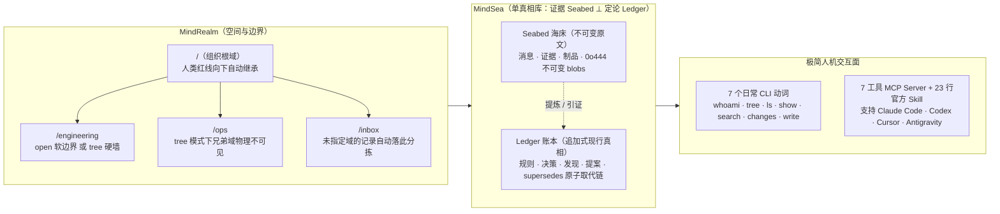

# Meru Mind

**面向下一代人机团队的「空间隔离 × 单真相库分层演化」共享上下文内核。**

[English README](./README.md) · [架构设计 (ARCHITECTURE.md)](./ARCHITECTURE.md) · [安全威胁模型 (THREAT_MODEL.md)](./THREAT_MODEL.md) · [云端部署与可组合前端指南](./docs/deployment-and-frontend.md) · [自定义前端搭建 Skill](./docs/UI_BUILDER_SKILL.md)

Meru Mind 是一个**零 Docker、单 SQLite、MIT 开源**的 TypeScript 引擎（`CLI` + `MCP Server` + `HTTP/WS 服务` + `可组合 Web 治理前端` + `SDK`），将 **空间与可见性（`MindRealm`）** 与 **时间与真相深度（`MindSea`）** 正交分离——让多个人类与编码 Agent 共享规矩、决策与排查证据，避免上下文爆炸、过期结论复活与跨分支泄密。



---

## 核心设计优势

- **树状空间隔离与继承（`open | tree`）**：所有读写、检索、向量查询与只读切片导出均经过同一套纯函数策略引擎（`src/policy.ts`）。`tree` 模式下兄弟分支在 Top-K 之前即被 SQL/分区键物理排除；祖先规矩向下继承；跨分支访问必须经人类显式 `@mount`。
- **单真相库，证据（`Seabed`）与定论（`Ledger`）分层**：在同一座 SQLite 真相库内，不可变原始证据（`seabed_entries` + `0o444` 内容寻址 `blobs/`）与水上定论（带原子 `supersedes` 取代链和合规级 `redact` 字节抹除的 `records`）严格分层；FTS5 与可选 `sqlite-vec` 等派生索引随时可用 `admin rebuild` 无损重建。
- **零 Docker、确定性毫秒级召回**：直接构建于 Node.js 22+ 内置 `node:sqlite`（WAL + CJK 双字 FTS5 + 局部滑动窗口覆盖度），无外部数据库、无重中间件。
- **极简 7 工具 MCP + 23 行 Skill**：引导 Agent 稳定执行 `whoami -> tree -> show <realm> -> search` 冷启动节奏，不浪费上下文预算。

---

## 60 秒快速上手

环境要求：**Node.js >= 22.13**（使用内置 `node:sqlite`，目前为 Node.js 实验内置模块，CI 已覆盖 Node 22 与 Node 24 矩阵）。

```bash
pnpm install
pnpm build
pnpm test
```

运行时数据**强制存放在代码仓外部**（默认 `~/.meru-mind`，可通过 `MERU_MIND_HOME` 或 `--home` 指定）。

```bash
export MERU_MIND_HOME="$HOME/.meru-mind-quickstart"

# 1. 初始化组织与根域
node dist/cli.js admin init --org "Acme"

# 2. 创建子域（域拓扑与生命周期变更均需 --as-human）
node dist/cli.js realm create --parent / --slug backend --name "Backend" --scope "Include: APIs, storage, deploys. Exclude: marketing." --as-human
node dist/cli.js realm create --parent / --slug marketing --name "Marketing" --scope "Include: launches, campaigns. Exclude: infra." --as-human

# 3. 写入全局红线、指定域决策、以及零参数随手记（自动路由到 /inbox）
node dist/cli.js rule add --in / --title "未过 CI 严禁发布生产" --body "所有生产合入必须先过完整自动化测试。" --as-human
node dist/cli.js write --in /backend --kind decision --title "本地单机状态统一使用 SQLite WAL" --body "单写者 WAL 保持零 Docker 开箱体验。"
node dist/cli.js write --title "排查 p95 延迟毛刺" --body "不指定 --in 时自动落入 /inbox 等人工分拣。"

# 4. 查看身份、域树与子域简报（自动继承祖先红线）
node dist/cli.js whoami
node dist/cli.js tree
node dist/cli.js show /backend

# 5. 作用域全文检索（局部窗口覆盖度 + 自动压制被取代旧结论）
node dist/cli.js search "SQLite WAL" --in /backend

# 6. 人工分拣 /inbox 与归档旧域
node dist/cli.js entry move <rec_id> --to /backend --dry-run --as-human
node dist/cli.js realm archive /marketing --as-human

# 7. 启动单写者 HTTP + Pump WS + Streamable HTTP MCP + Web 治理前端（内置 Demo 数据）
node dist/cli.js serve --demo --host 127.0.0.1 --port 3800

# 8. 按需弹出官方前端壳让 Agent 定制，或绑定外部 Linear / GitHub 单真源任务
node dist/cli.js ui eject ./my-custom-ui
node dist/cli.js work bind --in /backend --provider github --repo acme/api --token-env GITHUB_TOKEN --as-human
```

---

## MCP 接入与 23 行官方 Skill

`meru-mind-mcp` 仅暴露 **7 个精炼工具**（`mind_whoami`、`mind_tree`、`mind_ls`、`mind_show`、`mind_search`、`mind_changes`、`mind_write`），进程内将 `actor.kind` 硬编码为 `"agent"`（规则写入、`redact`、域拓扑变更等高危治理指令仅保留在 CLI）。

```json
{
  "mcpServers": {
    "meru-mind": {
      "command": "node",
      "args": ["/path/to/meru-mind/dist/mcp.js"],
      "env": {
        "MERU_MIND_HOME": "/path/to/your/data-dir"
      }
    }
  }
}
```

配合 [`skills/meru-mind/SKILL.md`](./skills/meru-mind/SKILL.md)（23 行官方 Skill）即可接入 Claude Code、Codex、Cursor 或 Antigravity。配置 `MERU_MIND_EMBED_URL` / `MERU_MIND_EMBED_API_KEY` 后可按需开启 `sqlite-vec` 混合检索；未配置或离线时自动退化为纯 FTS5。

---

## 稳定性承诺、实验面与已知局限

### 稳定性与落盘承诺（`0.x`）
- **`0.x` 稳定契约**：承诺 **7 个日常 CLI 动词名**、**7 个 MCP 工具名**、**`MindSurface` TypeScript 统一门面**，以及 **SQLite 数据库只向前兼容迁移**（`v0.2.0` 创建的 `mind.sqlite` 后续版本皆可无损打开，迁移前自动做 `VACUUM INTO` 快照；不支持降级）。
- **`0.x` 非稳定面**：Markdown 输出排版、排序权重与底层内部适配器导出符号在 `0.x` 期间可能调整。
- **实验功能面**（已在 `--help` 标注 `[experimental]`，未写入官方 Skill）：`file`（本地共享文件盘）、`raw`（直接写入海床 CLI）、`settle`（蒸馏卡片）及 `thing` 记录类型。
- **SQLite 唯一核心后端**：SQLite（`node:sqlite` WAL）是唯一核心存储与在线真源；未来迁移至 Postgres 属于由明确容量指标触发的独立迁移项目，不承诺接口层零重写替换。

### 已知局限（`v0.5.1`）
1. **默认纯字面检索**：未配置外部 Embedding 时仅使用 CJK 双字 + 拉丁 FTS5 与局部窗口覆盖度。
2. **批量导入不自动建 `supersedes` 链**：导入语料中未声明取代关系的新旧文档会并排保持 `active`（日常写入已提供中性相似条目回显，方便 Agent 显式挂取代链）。
3. **单写者 SQLite 服务约束**：`meru-mind serve` 持有独占写锁，需部署在带持久本地块存储的单实例节点（避免多副本共享 NFS/SMB）。
4. **`node:sqlite` 实验接口**：属于 Node.js 当前实验内置 API，CI 已覆盖 Node 22 与 Node 24 矩阵。

---

## 内部评测方法与实测结果（附 4 条诚实限定）

我们在关闭向量检索（`vector_enabled: false`）的纯确定性内核下，对照真实文件型个人/工程知识库基线进行了 **7 轮零重叠留出集（R2–R8，共 222 道配对题）** 盲测（同等调用次数与字符预算；Round 6–8 在开跑前经独立盲审审计修清泄露点，全链路空气隔离宿主记忆，并由双盲裁判在独立平衡翻转与乱序批次上交叉评分）：

- **七轮累计（222 道零重叠配对题，R2–R8）**：Meru Mind 全对 **`181/222 (81.5%)`** vs 基线 **`161/222 (72.5%)`**（`+9.0 pp`）；严格分数配对 **`45W / 17L / 160T`**（双侧精确二项符号检验 **`p = 0.0005`**）。
- **最新 Round 8（`v0.5.1`，空气隔离 Skill-vs-Skill，31 道有效配对题；Meru Mind `0/32` 报错，基线 `1/32` 解析报错隔离）**：
  - **主盲评裁判**：Meru Mind **`26/31 (83.9%)`**（均分 `87.1%`、可答 `22/27`、负样本弃权 `4/4`、被取代回归 `0/6`）vs 基线 **`23/31 (74.2%)`**（均分 `79.0%`、可答 `19/27`、负样本弃权 `4/4`、被取代回归 `0/6`）；严格配对 **`6W / 2L / 23T`**（对 2 道失分题做 `v0.5.0` 机械对照重放与逐行 CLI Diff 核实，`0` 例归因于 `v0.5.1` 改动）。
  - **第二盲评裁判（独立反向翻转 + 乱序）**：Meru Mind **`24/31 (77.4%)`**（均分 `83.9%`）vs 基线 **`22/31 (71.0%)`**（均分 `77.4%`），配对 `7W / 4L / 20T`；双裁判严格胜负序一致率 **`28/31 (90.3%)`**（A/B 互换题 `12/14 = 85.7%`）。
  - **内核召回与延迟**：Gold Hit@10 **`22/28 (78.6%)`** vs 基线 **`18/28 (64.3%)`**（`+14.3 pp`），MCP 常驻热态 **`p50 = 33.1 ms / p95 = 69.6 ms`**，CLI 冷启动 **`155.4 ms`** vs **`5,092.5 ms`**（快 **`32.8×`**），端到端单题工具耗时 **`499 ms`** vs **`8,151 ms`**（快 **`16.3×`**），平均字符输出 **`6,579` vs `8,531`**（省 **`22.9%`**）。

> **4 条诚实限定**：
> 1. 评测语料为作者私有真实工作库（21,166 条 Atom + 2,104 篇 Markdown），外部开发者无法直接下载复现（评测脚本不入本开源仓）。
> 2. 全程关闭向量检索（`vector_enabled: false`），只衡量确定性 SQLite FTS5 + 领域结构 + 时间戳/取代图谱内核。
> 3. 222 题累计跨越 `v0.2a Slice 1` 至 `v0.5.1` 多个演进版本（各轮零重叠），并非单一冻结提交；单轮 `n = 31` 用于验证无退步，统计显著性来自七轮累计。
> 4. 双裁判属同模型家族双盲交叉审计（独立平衡翻转与乱序），非跨模型家族裁判。

---

## 已交付能力演进（`v0.2.0` → `v0.5.1`）

完整云端自托管部署方案、安全模型与自定义前端指南见 [`docs/deployment-and-frontend.md`](./docs/deployment-and-frontend.md)、[`docs/UI_BUILDER_SKILL.md`](./docs/UI_BUILDER_SKILL.md) 与 [`THREAT_MODEL.md`](./THREAT_MODEL.md)：

- **`v0.2.0`**：树状空间隔离 `MindRealm`（`open | tree` + `@mount`）、单真相库分层 `MindSea`（证据 `Seabed` ⊥ 定论 `Ledger`）、7 动词 CLI、7 工具 stdio MCP + 23 行官方 Skill、合规级 `redact`、只读切片导出与 Node 22/24 CI。
- **`v0.2.1`**：有方向跨 kind 取代、中性写入相似回显、导入保留同日精确时间戳、确定性 L1 简报（规则永不截断）与迁移前自动 `VACUUM INTO` 快照。
- **`v0.3.0`**：统一 `MindSurface` 门面（`LocalMindSurface` / `RemoteMindSurface`）、单写者 `meru-mind serve` 独占锁、哈希 Bearer Token 管理（`meru-mind token`）、写期 Secret Guard、泵模型 + 长轮询（`GET /v1/changes?wait=25`）、Streamable HTTP MCP（`/mcp`）、`meru-mind admin backup` 与云端部署套件（`deploy/Dockerfile`、`docker-compose.yml`、`Caddyfile`、`fly.toml`）。
- **`v0.4.0`**：零新增依赖 1.5 层可组合 Web 治理前端——服务端托管 `/_meru/client.js`（泵状态、CAS `inbox.triage()`、消毒 Shadow DOM `<meru-entry>`、可见作用域快照）、内置 `/_meru/shell` 官方壳、7 条件泵 WebSocket（`WS /v1/ws`）、进程内 `MindPulse`、60 秒一次性 CLI 登录码换弱化 `HttpOnly; SameSite=Strict` Cookie（`meru-mind ui login`）、`meru-mind ui eject`、`--demo` 对抗演练沙箱与 6 条安全硬护栏。
- **`v0.5.0`**：单真源 `WorkProvider` 窄契约（`mind-core` 零任务表、MCP 严格保持 7 工具）、官方 Linear 与 GitHub Provider、`work_bindings`（强制仅存 `env:VAR` 凭据引用）、熔断降级、`DeliveryRetryWorker` 指数退避重试与死信、以及本地/远程 `meru-mind work` 命令。
- **`v0.5.1`**：下划线 `_` 词边界与 SQLite FTS5 `unicode61` 对齐（普通词与纯 `snake_case` 跨 `_` 正常命中，带 `- / :` 的服务名与路径保留严格兄弟隔离；零数据库迁移）以及覆盖优先 `<= 240` 字两段摘要拼接（结合候选池稀有词兜底；标题与首段已覆盖全词时 `100%` 逐字节不变）。

## 开源协议

MIT
