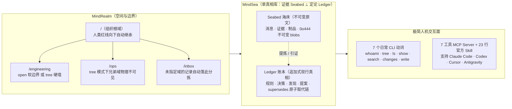

# Meru Mind

**面向下一代人机团队的「空间隔离 × 单真相库分层演化」共享上下文内核。**

[English README](./README.md) · [架构设计 (ARCHITECTURE.md)](./ARCHITECTURE.md) · [云端部署与可组合前端指南](./docs/deployment-and-frontend.md)

Meru Mind 是一个**零 Docker、单 SQLite、MIT 开源**的 TypeScript 引擎（`CLI` + `MCP Server` + `SDK`），将 **空间与可见性（`MindRealm`）** 与 **时间与真相深度（`MindSea`）** 正交分离——让多个人类与编码 Agent 共享规矩、决策与排查证据，彻底告别上下文爆炸、过期结论复活与跨分支泄密。



---

## 核心设计优势

- **树状空间隔离与继承（`open | tree`）**：所有读写、检索、向量查询与只读切片导出均经过同一套纯函数策略引擎（`src/policy.ts`）。`tree` 模式下兄弟分支在 Top-K 之前即被 SQL/分区键物理排除；祖先规矩向下继承；跨分支访问必须经人类显式 `@mount`。
- **单真相库，证据（`Seabed`）与定论（`Ledger`）分层**：在同一座 SQLite 真相库内，不可变原始证据（`seabed_entries` + `0o444` 内容寻址 `blobs/`）与水上定论（带原子 `supersedes` 取代链和合规级 `redact` 字节抹除的 `records`）严格分层；FTS5 与可选 `sqlite-vec` 等派生索引随时可用 `admin rebuild` 无损重建。
- **零 Docker、确定性毫秒级召回**：直接构建于 Node.js 22+ 内置 `node:sqlite`（WAL + CJK 双字 FTS5 + 局部滑动窗口覆盖度），无外部数据库、无重中间件。
- **极简 7 工具 MCP + 23 行 Skill**：引导 Agent 稳定执行 `whoami -> tree -> show <realm> -> search` 冷启动节奏，不浪费上下文预算。

---

## 60 秒快速上手

环境要求：**Node.js >= 22.13**（使用内置 `node:sqlite`，目前为 Node.js 实验内置模块，CI 已覆盖 Node 22 与 Node 24 矩阵）。

```bash
pnpm install
pnpm build
pnpm test
```

运行时数据**强制存放在代码仓外部**（默认 `~/.meru-mind`，可通过 `MERU_MIND_HOME` 或 `--home` 指定）。

```bash
export MERU_MIND_HOME="$HOME/.meru-mind-quickstart"

# 1. 初始化组织与根域
node dist/cli.js admin init --org "Acme"

# 2. 创建子域（域拓扑与生命周期变更均需 --as-human）
node dist/cli.js realm create --parent / --slug backend --name "Backend" --scope "Include: APIs, storage, deploys. Exclude: marketing." --as-human
node dist/cli.js realm create --parent / --slug marketing --name "Marketing" --scope "Include: launches, campaigns. Exclude: infra." --as-human

# 3. 写入全局红线、指定域决策、以及零参数随手记（自动路由到 /inbox）
node dist/cli.js rule add --in / --title "未过 CI 严禁发布生产" --body "所有生产合入必须先过完整自动化测试。" --as-human
node dist/cli.js write --in /backend --kind decision --title "本地单机状态统一使用 SQLite WAL" --body "单写者 WAL 保持零 Docker 开箱体验。"
node dist/cli.js write --title "排查 p95 延迟毛刺" --body "不指定 --in 时自动落入 /inbox 等人工分拣。"

# 4. 查看身份、域树与子域简报（自动继承祖先红线）
node dist/cli.js whoami
node dist/cli.js tree
node dist/cli.js show /backend

# 5. 作用域全文检索（局部窗口覆盖度 + 自动压制被取代旧结论）
node dist/cli.js search "SQLite WAL" --in /backend

# 6. 人工分拣 /inbox 与归档旧域
node dist/cli.js entry move <rec_id> --to /backend --dry-run --as-human
node dist/cli.js realm archive /marketing --as-human
```

---

## MCP 接入与 23 行官方 Skill

`meru-mind-mcp` 仅暴露 **7 个精炼工具**（`mind_whoami`、`mind_tree`、`mind_ls`、`mind_show`、`mind_search`、`mind_changes`、`mind_write`），进程内将 `actor.kind` 硬编码为 `"agent"`（规则写入、`redact`、域拓扑变更等高危治理指令仅保留在 CLI）。

```json
{
  "mcpServers": {
    "meru-mind": {
      "command": "node",
      "args": ["/path/to/meru-mind/dist/mcp.js"],
      "env": {
        "MERU_MIND_HOME": "/path/to/your/data-dir"
      }
    }
  }
}
```

配合 [`skills/meru-mind/SKILL.md`](./skills/meru-mind/SKILL.md)（23 行官方 Skill）即可接入 Claude Code、Codex、Cursor 或 Antigravity。配置 `MERU_MIND_EMBED_URL` / `MERU_MIND_EMBED_API_KEY` 后可按需开启 `sqlite-vec` 混合检索；未配置或离线时自动退化为纯 FTS5。

---

## 稳定性承诺、实验面与已知局限

### 稳定性与落盘承诺（`0.x`）
- **`0.x` 稳定契约**：仅承诺 **7 个日常 CLI 动词名**、**7 个 MCP 工具名**，以及 **SQLite 数据库只向前兼容迁移**（`v0.2.0` 创建的 `mind.sqlite` 后续版本皆可无损打开；不支持降级）。
- **`0.x` 非稳定面**：Markdown 输出排版、排序权重与 TypeScript 内部导出符号在 `0.x` 期间可能调整；首个稳定编程门面将在 `v0.3` 以 `MindSurface` 形式提供。
- **实验功能面**（已在 `--help` 标注 `[experimental]`，未写入官方 Skill）：`file`（本地共享文件盘）、`raw`（直接写入海床 CLI）、`settle`（蒸馏卡片）及 `thing` 记录类型。
- **SQLite 唯一核心后端**：SQLite（`node:sqlite` WAL）是唯一核心存储与在线真源；未来迁移至 Postgres 属于由明确容量指标触发的独立迁移项目，不承诺接口层零重写替换。

### 已知局限（`v0.2.0`）
1. **默认纯字面检索**：未配置外部 Embedding 时仅使用 CJK 双字 + 拉丁 FTS5 与局部窗口覆盖度。
2. **批量导入不自动建 `supersedes` 链**：导入语料中未声明取代关系的新旧文档会并排保持 `active`。
3. **同日无时分秒时间戳回落入库序**：同一天仅有日期（`YYYY-MM-DDT00:00:00.000Z`）的多条导入记录，当前新旧平局排序会回落到入库 `created_at`（已在 `v0.2.1` 排期修复）。
4. **`node:sqlite` 实验接口**：属于 Node.js 当前实验内置 API，CI 已覆盖 Node 22 与 Node 24 矩阵。

---

## 内部评测方法与实测结果（附 4 条诚实限定）

我们在关闭向量检索（`vector_enabled: false`）的纯确定性内核下，对照真实文件型个人/工程知识库基线进行了 **5 轮零重叠留出集（R2–R6，共 159 道配对题）** 盲测（同等调用次数与字符预算；Round 6 在开跑前经独立盲审审计修清全部泄露点，全链路空气隔离宿主记忆，并由双盲裁判在独立平衡翻转与乱序批次上交叉评分）：

- **五轮累计（159 道零重叠配对题）**：Meru Mind 全对 **`127/159 (79.9%)`** vs 基线 **`114/159 (71.7%)`**；严格分数配对 **`31W / 14L / 114T`**（双侧精确二项符号检验 `p = 0.016`）。
- **最新 Round 6（空气隔离 Skill-vs-Skill，31 道有效配对题）**：双盲裁判一致给出 Meru Mind **`25/31 (80.6%)`** vs 基线 **`21/31 (67.7%)`**（配对 `8W / 4L / 19T` 与 `7W / 3L / 21T`），被取代回归 `0`，负样本正确弃权 `4/4`，MCP 常驻热态延迟 **`p50 = 32.1 ms / p95 = 71.6 ms`**，平均单题工具耗时 **`293 ms`** vs **`6,750 ms`**（快 **`23×`**）。

> **4 条诚实限定**：
> 1. 评测语料为真实私有工作库，外部开发者无法直接下载复现（评测脚本不入本开源仓）。
> 2. 全程关闭向量检索（`vector_enabled: false`），只衡量确定性存储与字面检索内核。
> 3. 159 题累计跨越 V0.2a 多个演进切片（R2–R6），并非单一冻结提交。
> 4. 最新单轮 Round 6（`n = 31`, `8W / 4L`, `p = 0.39`）在单轮样本量下尚不构成独立显著性。

---

## 演进路线图与云端/前端设计

完整云端自托管部署方案与「原子组件 + Agent 现搓独特前端」设计见 [`docs/deployment-and-frontend.md`](./docs/deployment-and-frontend.md)：

- **`v0.2.1`**：有方向跨 kind 取代、中性写入回显、导入保留精确时间戳修同日排反 Bug、L1 确定性简报选材（规则永不截断）。
- **`v0.3`**：单进程 `meru-mind serve`（Token 哈希 + `Principal`、`MindSurface` 契约双跑、单写者独占锁、泵模型 + 长轮询、游标碰撞提示、`VACUUM INTO` CI 恢复演练、Docker/Caddy/Fly.io 部署套件）。
- **`v0.4`**：可组合 Web 治理前端（`@meru-mind/client` Headless 泵 SDK + `@meru-mind/ui-atoms` 8 个原子积木 + 极简默认壳 + `UI_BUILDER_SKILL.md` 让用户 Agent 60 秒按个人品味搓出独特界面）、泵上 `WS /v1/ws` + 长轮询降级、极薄 `MindPulse`。
- **`v0.5`**：单真源 `WorkProvider` 窄契约（内核 0 任务表、MCP 保持 7 动词）+ Linear & GitHub 双官方 Provider + `deliveries` 退避队列。

## 开源协议

MIT
