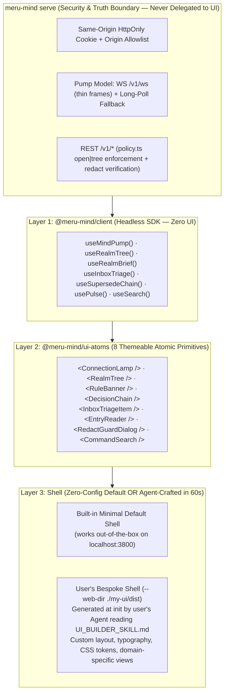

# Cloud Deployment & Composable AI-Built Frontend Architecture

> Design reference for Meru Mind `v0.3` (Team Server) and `v0.4` (Composable Web Governance Surface).

---

## Part 1: Deploying `meru-mind serve` to Cloud Servers (`v0.3`)

### Core Physical Constraint: Single-Writer SQLite WAL
Meru Mind `v0.3+` runs as a **single Node.js 22+ process owning one SQLite WAL database with an exclusive lock**.
- **Best fit**: Single-instance compute with a **persistent local block volume** (VPS / ECS / GCE / Fly.io Machines / Railway / Render Disk).
- **Avoid**: Multi-replica stateless containers sharing SQLite over NFS/SMB (breaks WAL locking) or ephemeral disks without persistent volumes.

### Deployment Option A: Standard Cloud VPS / Docker Compose + Caddy (Recommended for Teams)

A 1 vCPU / 1 GB RAM instance handles a small-to-medium human-AI team comfortably with zero heavy middleware (no Kafka, no Elasticsearch, no Neo4j, no CockroachDB).

```
Internet (HTTPS / WSS)
   │
   ▼
[Caddy Reverse Proxy]  (auto Let's Encrypt TLS + WS Upgrade + Origin pass-through)
   │  http://meru-mind:3800
   ▼
[meru-mind serve]      (non-root Node 22-slim container, single writer, exclusive lock)
   ├── /v1/*           REST API (MindSurface + Long-Poll)
   ├── /mcp            Streamable HTTP MCP (7 tools)
   ├── /v1/ws          v0.4 Pump WebSocket (same-origin HttpOnly Cookie + Origin check)
   └── /               Static Web Governance UI (--web-dir overrideable!)
   │
   ▼
[Persistent Disk Volume: /var/lib/meru-mind]
   ├── mind.sqlite (+ -wal / -shm)
   ├── blobs/          (0o444 immutable evidence)
   └── backups/        (scheduled VACUUM INTO snapshots; optional Litestream → S3/R2/GCS)
```

Key operational guardrails:
1. **Secrets stay in environment variables** (`MERU_MIND_ORIGIN`, `LINEAR_API_KEY`, etc.) — never stored in SQLite tables or `work_bindings.config_json`.
2. **Disaster recovery**: Built-in scheduled `VACUUM INTO` atomic snapshots (restore drill verified in CI), optionally paired with [Litestream](https://litestream.io/) for continuous WAL replication to S3 / R2 / GCS.
3. **Managed multi-tenant hosting**: **One SQLite database file (or isolated container) per tenant** — eliminates cross-tenant data leaks structurally and pushes Postgres migration far out.

### Deployment Option B: One-Command PaaS (Fly.io / Railway / Render)
Mount a 1 GB persistent volume at `/var/lib/meru-mind`, pin **`max_machines = 1, min_machines = 1`** (strict single-writer), set `MERU_MIND_HOME=/var/lib/meru-mind`, and expose `/healthz`.

---

## Part 2: Composable Frontend Architecture (`v0.4`) — "UI Atoms + Agent-Crafted Bespoke Shell"

Instead of shipping a rigid monolithic SaaS clone or building a bloated drag-and-drop website builder, Meru Mind `v0.4` takes an **AI-Native composable architecture** inspired by headless state primitives + shadcn-style UI atoms:



### Why This Works (First Principles)
1. **Hard protocol & security plumbing is locked once**: Agents crafting a custom UI never touch raw WebSocket reconnection, `(generation, cursor)` catch-up, long-poll proxy fallback, `HttpOnly` cookie sessions, or `redact` safety confirmations — all of that lives inside `@meru-mind/client` and `@meru-mind/ui-atoms`.
2. **Server remains the sole security boundary**: Even if a user's Agent writes a buggy custom layout, `meru-mind serve` enforces `open | tree` visibility, human/agent principal identity, `Origin` allowlists, and `redact` checks on every request.
3. **Zero cold-start friction + infinite personalization**:
   - First-time users immediately get a clean, minimal **Default Shell** served directly from `meru-mind serve` (zero CORS, single port, Vite + React 19 + TypeScript + Tailwind CSS v4).
   - Teams or individuals who want a tailored workspace (e.g., an ops incident dashboard, a warm editorial notebook, or a minimal keyboard-first terminal console) simply ask their coding agent — guided by `UI_BUILDER_SKILL.md` — to compose a bespoke shell from the 8 atomic primitives and CSS design tokens, build static assets, and mount them via `meru-mind serve --web-dir ./my-ui/dist`.
